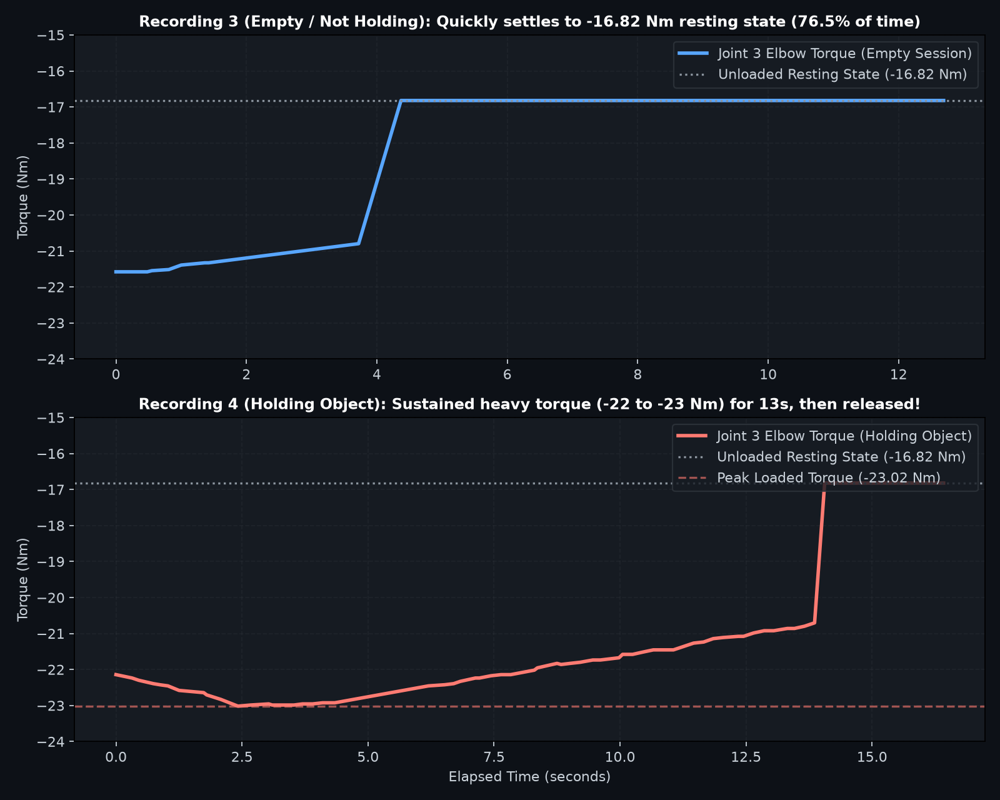

# feels

Lightweight physical AI and robotics repository powered by the [Viam Python SDK](https://github.com/viamrobotics/viam-python-sdk) and AI agent workflows.

---

## Overview

This repository is designed for rapid development and testing of robotic workflows with Viam. It includes:
- **`viam-python`** async client scripts to interface with machine hardware.
- **Agentic Skills & Plugins** from [`viam-devrel/agent-skills`](https://github.com/viam-devrel/agent-skills) to provide LLM agents (Claude Code, Antigravity, Cursor) with deep robotics SDK expertise.
- **Safety Directives** configured for collision avoidance, safe Z-boundaries, and heartbeat management.

### Target Machine & Components

- **Machine Address:** `sfhack12-main.ty1cywh7tq.viam.cloud`
- **Configured Components:**
  - `arm` (`Arm`): Robotic arm position and trajectory control
  - `cam` (`Camera`): Vision stream and image acquisition
  - `gripper` (`Gripper`): End-effector grasp and state detection
  - `table` (`Gripper`): Auxiliary fixture / table gripper
  - `ceiling` (`Gripper`): Overhead gripper mechanism

---

## Agentic Skills & Marketplace

This repo integrates with the official **Viam Agent Skills** repository: [`viam-devrel/agent-skills`](https://github.com/viam-devrel/agent-skills).

### 1. Claude Code Plugin Marketplace

To enable Viam agent skills inside **Claude Code**, run:

```bash
# Add the marketplace
/plugin marketplace add viam-devrel/agent-skills

# Install the Python SDK skill
/plugin install viam-python@viam-agent-skills

# (Optional) Install the full bundle or other skills
/plugin install viam-skills@viam-agent-skills
/plugin install viam-modules-fleet@viam-agent-skills
/plugin install local-viam-server@viam-agent-skills
```

### 2. Antigravity / Cursor Agents

- **Workspace Skill:** The repository includes `.agents/skills/viam-python/` containing verified SDK references and cheatsheets. Agents running in Antigravity or Cursor automatically discover these instructions.
- **CLI Plugin (agy):**
  ```bash
  agy plugin install /path/to/agent-skills/plugins/viam-python
  ```

### Available Skills in `viam-devrel/agent-skills`

| Skill | Description |
|---|---|
| `viam-python` | Async patterns, component/service APIs, module development, image transforms |
| `viam-go-motion-vision` | Motion planning, WorldState, frame system, and spatial math (Go) |
| `viam-modules-fleet` | CLI, module packaging, registry, fleet configuration |
| `local-viam-server` | Spin up a local `viam-server` linked to cloud machine parts |
| `viam-machine-config` | Read and deploy machine configuration via the Viam app API |
| `viam-ml` | Training data capture and model deployment |

---

## SDKs & Prerequisites

- **Python:** 3.10+ (Python 3.12 recommended)
- **Core SDKs:**
  - `viam-sdk` (`>=0.85.0`)
  - `python-dotenv` (`>=1.0.0`)
  - `pymongo` (`>=4.10.0`) *(optional, for Atlas telemetry & state persistence)*

---

## Getting Started

### 1. Virtual Environment Setup

Create and activate a Python virtual environment:

```bash
# Create venv
python3 -m venv .venv

# Activate venv (Linux/macOS)
source .venv/bin/activate

# Install dependencies
pip install --upgrade pip
pip install -r requirements.txt
```

### 2. Configure Credentials

Copy the template environment file and fill in your machine credentials:

```bash
cp .env.example .env
```

Edit `.env`:
```env
VIAM_API_KEY=your_api_key_here
VIAM_API_KEY_ID=your_api_key_id_here
VIAM_MACHINE_ADDRESS=sfhack12-main.ty1cywh7tq.viam.cloud
```

### 3. Run the Hardware Inspection Script

Test connection and query active components:

```bash
python main.py
```

### 4. Interactive Real-Time Visualizer & Weight Detection Dashboard

Launch the 10-second rolling telemetry dashboard with separated 6-joint axes and 1-click session recording:

```bash
python realtime_plot.py --port 8080
```
Open **`http://localhost:8080`** in any browser.

### 5. Inspect All Sensors and Encoders

```bash
python sensors.py
```

### 6. Force & Weight Sensitivity Analysis

```bash
python effective_force.py --duration 15.0
```

### 7. Zero-Latency On-Robot Control Service (`control_service.py`)

To eliminate the ~158ms WebRTC cloud latency and sample at 50–200 Hz, deploy [`control_service.py`](control_service.py) (`hackathons:control_logic:generic-service`) directly onto the robot host (`sfhack12`). Test with:

```bash
python client_control_service.py
```

### 8. Swirl Feature Extractor + 2-Mode Dashboard

The demo loop is pick-up → swirl → place, driven by `repeatable_grasp.py --swirl-smooth` (locked in, don't touch it). Everything below consumes its CSVs.

**Feature extractor:**

```bash
# Extract the 10-D vector + normalized embedding from a recording
python feature_extractor.py recordings/recording_20261029_180332_empty_cup.csv

# Recalibrate per-feature scales on your dataset (run once on P0 data, then freeze)
python feature_extractor.py --calibrate
```

Outputs `z` (10 interpretable features: mass offsets, swirl variances, peak-to-peak, phase lag, rattle energy, grip compliance, lift transient, swirl speed), `e` (L2-normalized embedding matching the Atlas `cup_dynamics_index`: 10 dims, cosine), and `diagnostics` (sampling rate, tare QC flags, rattle-band limits). The 5–25 Hz rattle band is **not** observable at 4–5 Hz cloud sampling — the extractor flags `rattle_band_limited` honestly; the real band needs the 100 Hz on-robot module (step 7).

**Dashboard API (2 modes):**

```bash
python realtime_plot.py --port 8080   # open http://localhost:8080
```

- **Mode 1 — Identify:** `POST /api/cycle/predict` runs the swirl macro on a mystery cup, extracts features, queries Atlas `$vectorSearch`, returns the label + confidence + top 3 neighbors.
- **Mode 2 — Teach:** `POST /api/cycle/teach` with `{"item_name": "..."}` runs the macro and inserts the signature into Atlas — instantly queryable, no retraining.
- `POST /api/cycle/abort` stops a running macro; `GET /api/status` reports cycle state, Viam address, and Atlas config.

**Mock mode (no robot / no Atlas):**

```bash
FEELS_MOCK=1 python realtime_plot.py --port 8080
```

Serves the full 2-mode UI from recorded data: predict runs the real extractor + a local cosine k-NN over the reference recordings; teach simulates the save. A purple **MOCK** badge is always shown — never demo it as live hardware.

**Offline classifier:**

```bash
python predict_mystery.py                        # classify mystery recordings
python predict_mystery.py recordings/foo.csv     # classify one CSV
python predict_mystery.py --eval                 # leave-one-recording-out accuracy
python predict_mystery.py --qc                   # tare-baseline quality gate per run
```

See [`BASELINE_FINDINGS.md`](BASELINE_FINDINGS.md) for the audit behind the QC checks.

---

## Experimental Findings: Weight Detection via Joint Torques

Even without a dedicated 6-axis F/T flange sensor, the xArm850 reports high-resolution joint loads via `arm.do_command({"load": ""})`.

1. **Posture Dynamics:**
   - In upright postures ($q_2 \approx 86^\circ$), the upper arm acts as an axial compression column, so vertical weight creates minimal angular moment on Joint 2 (Shoulder).
   - **Joint 3 (Elbow Pitch)** acts as the cantilever reaction pivot and absorbs the downward bending moment.
2. **Experimental Verification (Recordings 3 vs 4):**
   - **Empty / Resting State:** Joint 3 settles firmly to `-16.82 N·m`.
   - **Holding Payload:** Joint 3 deflects to **`-22.0` to `-23.02 N·m`** (a **`-6.20 N·m` shift**, equivalent to $\approx 1.4\,\text{kg}$ downward force).
   - When released, torque crisply snaps back from $-20.7 \to -16.82\,\text{N}\cdot\text{m}$.
   - CSV datasets, schema dictionary, and comparative figures are documented in [`recordings/README.md`](recordings/README.md).



---

## Baseline Code Sample

The baseline connection pattern in [`main.py`](main.py):

```python
import asyncio
from viam.robot.client import RobotClient
from viam.components.arm import Arm
from viam.components.camera import Camera
from viam.components.gripper import Gripper
from viam.services.generic import Generic as GenericService

async def connect():
    opts = RobotClient.Options.with_api_key(
        api_key='<API-KEY>',
        api_key_id='<API-KEY-ID>'
    )
    return await RobotClient.at_address('sfhack12-main.ty1cywh7tq.viam.cloud', opts)

async def main():
    async with await connect() as machine:
        print('Resources:')
        print(machine.resource_names)
        
        # arm
        arm: Arm = Arm.from_robot(machine, "arm")
        arm_return_value = await arm.get_end_position()
        print(f"arm get_end_position return value: {arm_return_value}")

        # cam
        cam: Camera = Camera.from_robot(machine, "cam")
        cam_return_value = await cam.get_images()
        print(f"cam get_images return value: {cam_return_value}")

        # gripper
        gripper: Gripper = Gripper.from_robot(machine, "gripper")
        gripper_return_value = await gripper.is_moving()
        print(f"gripper is_moving return value: {gripper_return_value}")

        # table
        table: Gripper = Gripper.from_robot(machine, "table")
        table_return_value = await table.is_moving()
        print(f"table is_moving return value: {table_return_value}")

        # ceiling
        ceiling: Gripper = Gripper.from_robot(machine, "ceiling")
        ceiling_return_value = await ceiling.is_moving()
        print(f"ceiling is_moving return value: {ceiling_return_value}")

if __name__ == "__main__":
    asyncio.run(main())
```

---

## 8. Repeatable Grasping Workflow (Arm Saver Positions)

Using the newly configured `erh:vmodutils:arm-position-saver` switches on `sfhack12`, automated pick-and-place trajectories can be reliably commanded with synchronized gripper open/close operations:

### Configured Static Waypoints

| Waypoint Switch | Description | X (mm) | Y (mm) | Z (mm) | Orientation |
|---|---|---|---|---|---|
| **`home-pose`** | Ready / staging position | 466.27 | 383.55 | 250.57 | $\theta=178.4^\circ, (0.421, -0.904, -0.072)$ |
| **`approach`** | Pre-grasp alignment above object | 370.96 | 320.94 | 66.45 | $\theta=174.0^\circ, (0.548, -0.834, -0.059)$ |
| **`grasp`** | Target contact / grip position | 446.58 | 239.78 | 70.42 | $\theta=175.7^\circ, (0.381, -0.922, -0.068)$ |
| **`travel`** | High transit clearance waypoint | 562.62 | 331.21 | 196.26 | $\theta=179.5^\circ, (0.345, -0.938, 0.022)$ |
| **`place`** | Deposit / placement target | 647.13 | 193.54 | 96.17 | $\theta=177.8^\circ, (0.715, -0.684, -0.147)$ |

### Sequence Flow

```
[home-pose] (gripper open) 
     │
     ▼
 [approach] (pre-grasp alignment)
     │
     ▼
  [grasp]   ──► gripper.grab() (close jaws)
     │
     ▼
  [travel]  (lift & translate with payload at Z=196mm)
     │
     ▼
  [place]   ──► gripper.open() (deposit object at Z=96mm)
     │
     ▼
  [travel]  (retract upwards to avoid collision)
     │
     ▼
[home-pose] (gripper open, ready for next cycle)
```

### Usage

```bash
# Run 1 full pick-and-place cycle
python repeatable_grasp.py

# Run multiple repeated cycles
python repeatable_grasp.py --cycles 3 --delay 1.5

# Step to a specific static position
python repeatable_grasp.py --step home-pose
python repeatable_grasp.py --step approach
python repeatable_grasp.py --step grasp
python repeatable_grasp.py --step travel
python repeatable_grasp.py --step place

# Manual gripper actuation
python repeatable_grasp.py --gripper open
python repeatable_grasp.py --gripper grab

# Inspect waypoints and status without moving (dry-run)
python repeatable_grasp.py --dry-run
```

---

## Safety Directives

When writing code that moves physical hardware, follow the rules defined in [`.cursorrules`](.cursorrules):

1. **Client Lifecycle & Heartbeat:** Always use `async with await connect() as machine:` to maintain the 2-second heartbeat and prevent estop triggers.
2. **Motion Planning:** Use `MotionClient.move()` with a valid `WorldState` rather than unconstrained raw arm motion.
3. **Hard Z-Boundary:** Always enforce $Z \ge 15\text{ mm}$ (`MIN_SAFE_Z_MM = 15.0`) to prevent collisions with the work surface.
4. **Two-Phase Grasping:** Always plan a pre-grasp pose $100\text{ mm}$ above the target before descending, and verify grasp using `await gripper.is_holding_something()`.

---

## Next Steps & Roadmap

See [**`PLAN.md`**](PLAN.md) for the concrete finish plan (tonight + demo day), and [**`TODO.md`**](TODO.md) for the longer research backlog:
1. **Simulator Integration:** Test PyBullet / URDF / MuJoCo / Viam mock components for collision-free trajectory testing.
2. **On-Robot Data Collection:** Deploy a low-latency daemon on `sfhack12` to poll at 100–200 Hz over direct socket (port 30000).
3. **Kinematic Posture Optimization:** Move arm to a cantilever pose ($q_2 \approx 45^\circ\text{--}60^\circ, q_3 \approx 45^\circ\text{--}90^\circ$) to maximize perpendicular moment arm and signal-to-noise ratio.
4. **Dynamic Trajectory Sensing:** Move beyond static mass detection with sine shakes, impulse freezes, and tilt sweeps.
5. **Controller Evaluation:** Test velocity control, Cartesian impedance/compliance mode, and motor stiffness tuning.
