# ML Pipeline — Feature Extraction, Embeddings & Atlas Vector Search

> [!IMPORTANT]
> **On-Site Deep Learning Training Archived:**
> We do NOT train CNNs, Transformers, or PyTorch neural networks on-site. Training deep networks under limited time and sample constraints risks severe overfitting and instability. Instead, we compute deterministic, hand-crafted physical features from the pick-up, swirl, and hold telemetry and map them to a normalized unit embedding $e \in \mathbb{S}^9$ for non-parametric MongoDB Atlas Vector Search (`$vectorSearch`).

---

## 0. Two models, one recording

A single swirl recording feeds **two independent heads**. The cascade answers the
*closed-set* question (empty / solid / liquid) from 30 protocol-robust features;
Atlas answers the *open-set* question (which exact cup is this, and is it something
I've never felt before) from the 10-D unit embedding. They share no parameters —
the cascade is the cross-check, Atlas is the memory.

*Slide export: [PNG](img/model-architecture.png).*

```mermaid
%%{init: {"theme":"base","themeVariables":{"clusterBkg":"#ffffff","clusterBorder":"#94a3b8","lineColor":"#64748b","textColor":"#0f172a","edgeLabelBackground":"#ffffff","fontSize":"16px"},"flowchart":{"curve":"basis","nodeSpacing":45,"rankSpacing":60,"padding":16,"wrappingWidth":400}}}%%
flowchart LR

  REC["📄&nbsp;&nbsp;<b>One swirl recording</b><br/>phase-tagged torque CSV<br/>INIT · GRASP · LIFT · <b>SWIRL</b> · PLACE"]

  subgraph MEM["🍃 &nbsp;OPEN-SET VECTOR MEMORY &nbsp;—&nbsp; MongoDB Atlas"]
    direction TB
    F2["<b>10-D z</b> · feature_extractor.py<br/>mass J2/J3 · swirl var J2/J3 · swirl ptp J3<br/>phase lag · rattle · grip compliance<br/>lift · swirl speed"]
    EMB["<b>scale, then L2-normalize</b><br/>÷ frozen FEATURE_SCALES<br/>→ unit embedding e ∈ 𝕊⁹"]
    VS["<b>$vectorSearch</b> · cup_dynamics_index<br/>cosine · 10 dims<br/>k-NN, numCandidates = 4k"]
    VOTE["<b>group by label</b> → mean cosine<br/><b>material_of()</b> → material vote<br/>water_025pct + water_100pct → water"]
    F2 --> EMB --> VS --> VOTE
  end

  subgraph CASC["🧪 &nbsp;CLOSED-SET CASCADE &nbsp;—&nbsp; models/cascade.joblib"]
    direction TB
    F1["<b>30 features</b> · train_classifier.features()<br/>per joint J2–J6: hold · grip-delta<br/>swirl std / ptp · lift ptp<br/>+ effective force · settle · phase lag<br/>swirl speed · grip std"]
    S1["<b>Stage 1</b> — StandardScaler → GradientBoosting<br/><i>empty vs loaded</i> — mass contrast"]
    S2["<b>Stage 2</b> — StandardScaler → LogisticRegression<br/>balanced, fit on loaded only<br/><i>solid vs liquid</i> — slosh vs rigid"]
    F1 --> S1
    S1 -->|"loaded"| S2
  end

  V1["🎯&nbsp;&nbsp;<b>empty · solid · liquid</b><br/>+ per-stage probability<br/><i>no swirl → liquid/solid flagged low-confidence</i>"]
  V2["🎯&nbsp;&nbsp;<b>which cup, and how sure</b><br/>label + material + top-k neighbours<br/><i>conf &lt; 0.82 or margin &lt; 0.02 → ambiguous</i>"]

  REC --> F1
  REC --> F2
  S1 -->|"empty"| V1
  S2 --> V1
  VOTE --> V2
  EMB -. "teach · insert signature, no retrain" .-> VS

  classDef mongo fill:#d1fae5,stroke:#047857,color:#042f21;
  classDef ours fill:#f1f5f9,stroke:#475569,color:#0f172a;
  classDef ui fill:#ede9fe,stroke:#6d28d9,color:#2e1065;
  classDef thing fill:#ffffff,stroke:#cbd5e1,color:#334155;
  class F1,S1,S2 ours;
  class F2,EMB,VS,VOTE mongo;
  class V1,V2 ui;
  class REC thing;
```



> **Training is leak-free by construction.** Recordings were collected in
> time-blocks per class, so a label-stratified split leaks the label through
> recording time. Both stages are evaluated on a *within-class time split*
> (earliest 70 % train / latest 30 % test). Test folds are small — treat the
> numbers in `train_classifier.py` as approximate.

---

## 1. Feature Extraction Pipeline (`feature_extractor.py`)

The feature extraction engine transforms variable-length time-series rollouts $D = \{s_t\}_{t=0}^T$ into a fixed 10-dimensional physical feature vector $z \in \mathbb{R}^{10}$, then calculates the normalized metric embedding $e \in \mathbb{S}^9$.

```
Telemetry Rollout D
  ├── Static lift hold ──► mass_j2, mass_j3 (gravity torque offsets)
  ├── Swirl orbit       ──► swirl_var_j2, swirl_var_j3, swirl_ptp_j3,
  │                        phase_lag_s, rattle_e (observable band only)
  ├── Lift transient   ──► lift_dyn_j3 (inertial cue)
  ├── Grip             ──► grip_comp (compliance under load)
  └── Excitation       ──► swirl_speed (normalization)
                                        ↓
                         Raw 10D Feature Vector z
                                        ↓
            Per-feature scaled, L2-normalized embedding e = Wz / ‖Wz‖₂
                                        ↓
                     MongoDB Atlas $vectorSearch Retrieval
```

### Phase 1: Static Hold (Gravitational Mass Proxy)
- Measures steady-state load torque difference on Joint 3:
  $$\Delta \tau_{\text{gravity}} = \bar{\tau}_{3,\text{hold}} - \tau_{\text{tare}}$$
- Directly estimates net payload mass:
  $$\hat{m} = \frac{|\Delta \tau_{\text{gravity}}|}{g \cdot L_3}$$

### Phase 2: Horizontal Orbital Swirl (Slosh, Chatter, and Viscosity)
During the smooth horizontal swirl orbit:
- **Swirl Torque Variance:**
  $$\text{Var}(\tau_{3,\text{swirl}}) = \frac{1}{N}\sum (\tau_3(t) - \bar{\tau}_3)^2$$
- **Swirl Torque Spectrum (observable band only):** FFT on the detrended J3 residual,
  $$Y(f) = \mathcal{F}\{r_3(t)\},$$
  integrated over the *observable* band only:
  $$E_{\text{rattle}} = \sum_{1.5\,\text{Hz} \le f \le f_s/2} |Y(f)|^2.$$
  At 4–5 Hz cloud sampling the 5–25 Hz rattle band is **not** observable
  (Nyquist ~2 Hz); the extractor flags `rattle_band_limited`. The true band
  needs the 100 Hz on-robot module (`control_service.py`, not yet deployed).
- **Swirl Phase Lag ($\phi_{\text{lag}}$):** lag of max |cross-correlation|
  between TCP speed and the J3 torque residual, within ±2 s:
  $$\phi_{\text{lag}} = \arg\max_{|\delta| \le 2} |R_{v, r_3}(\delta)|.$$
  - Distinguishes lagging fluid vortex slosh (water, viscous soap) from rigid lumped mass (near-zero lag).

### Full 10-Dimensional Feature Vector ($z$)

As implemented in `feature_extractor.py` (`FEATURE_NAMES`):

| Index | Feature | Physical Meaning | Item Separation Property |
|:-----:|---------|------------------|--------------------------|
| 0 | `mass_j2` | Static gravity torque offset, shoulder (J2) | Payload mass estimate |
| 1 | `mass_j3` | Static gravity torque offset, elbow (J3) | Payload mass estimate |
| 2 | `swirl_var_j2` | Torque variance at J2 during swirl | Slosh / loose-content energy |
| 3 | `swirl_var_j3` | Torque variance at J3 during swirl | Slosh / loose-content energy |
| 4 | `swirl_ptp_j3` | Peak-to-peak J3 torque during swirl | Shifting-mass swing |
| 5 | `phase_lag_s` | Lag of max \|xcorr(TCP speed, J3 residual)\| | **Large for viscous fluids; near-zero for rigid mass** |
| 6 | `rattle_e` | High-frequency energy, *observable band only* (1.5 Hz–Nyquist) | Loose-item energy; **band-limited at 4–5 Hz sampling** |
| 7 | `grip_comp` | Gripper position std during swirl | Squishy vs rigid contents |
| 8 | `lift_dyn_j3` | Dynamic J3 torque during lift | Inertial mass cue |
| 9 | `swirl_speed` | Mean TCP speed during swirl | Excitation normalization |

---

## 2. Normalized Metric Embedding ($e \in \mathbb{S}^9$)

Rather than relying on learned neural network parameters, the vector is
per-feature scaled (90th-percentile scales in `FEATURE_SCALES`, calibrated on
real recordings and frozen) and normalized to the unit hypersphere:

$$e = \frac{Wz}{\|Wz\|_2}$$

This ensures that MongoDB Atlas Vector Search computes exact cosine similarity without needing neural network training or backpropagation.

---

## 3. MongoDB Atlas Vector Search Pipeline

Atlas operates as our metric retrieval engine. Queries are executed using the native `$vectorSearch` aggregation stage against the `cup_dynamics_index`:

```javascript
[
  {
    $vectorSearch: {
      index: "cup_dynamics_index",
      path: "feature_vector",
      queryVector: query_embedding,
      numCandidates: 20,
      limit: 5,
      filter: { session: "thu" } // optional session filter
    }
  },
  {
    $project: {
      label: 1,
      properties: 1,
      score: { $meta: "vectorSearchScore" }
    }
  }
]
```

### Classification Verdict
The nearest neighbors are grouped by label, and the prediction is determined by:
1. **Predicted Label:** Class with the highest mean cosine similarity score among the top-k matches.
2. **Confidence Percentage:** Mean similarity score $\times 100\%$.
3. **Low-Confidence Flag:** Triggered if top confidence is below $0.80$, alerting the operator to check cup placement.

---

## 4. Online Recording & Instant Teaching (UX)

When registering a new or updated item:
1. Operator places the item on the taped square and inputs its label (e.g. `dish_soap_half`).
2. Robot executes the single pick-up, swirl, and place routine.
3. `feature_extractor.py` computes $e$.
4. A single call to `atlas.teach(label, e, raw_samples)` inserts the new signature into the `signatures` collection.
5. The item is **immediately indexable and queryable** by subsequent runs without retraining or downtime.
