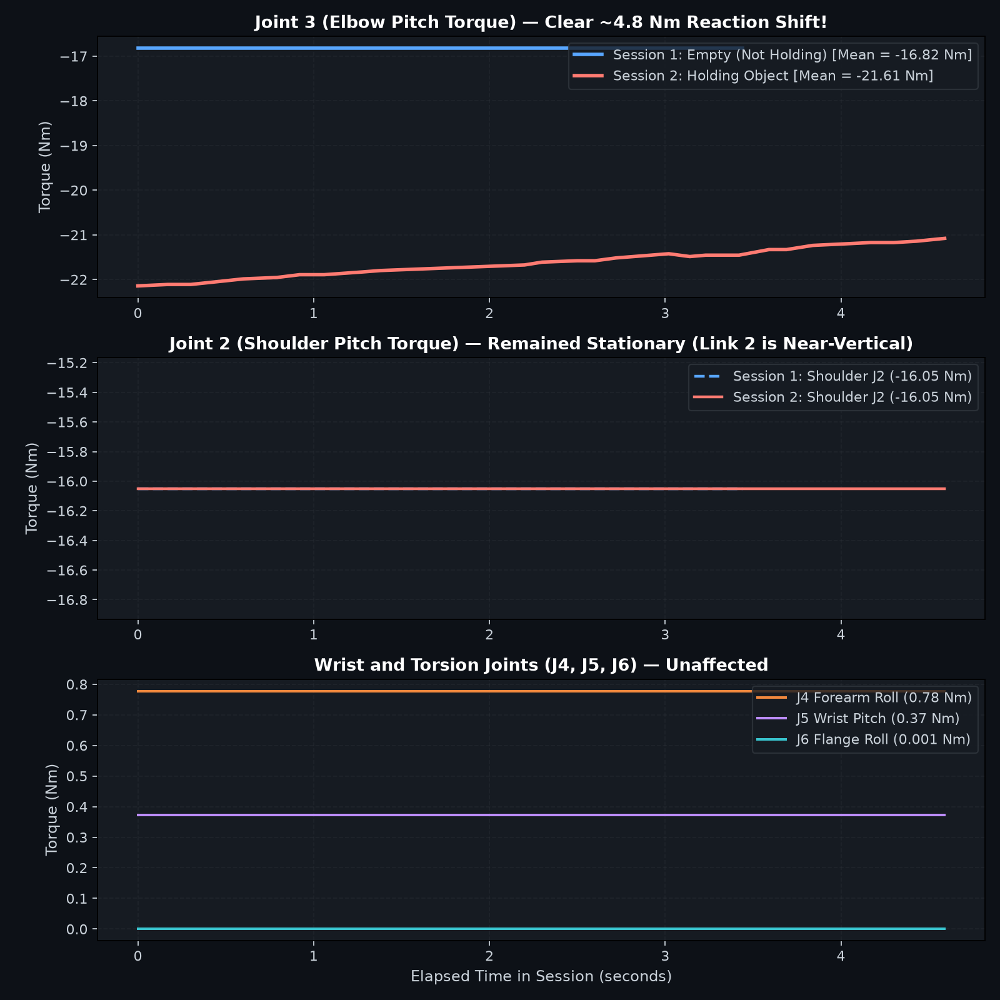
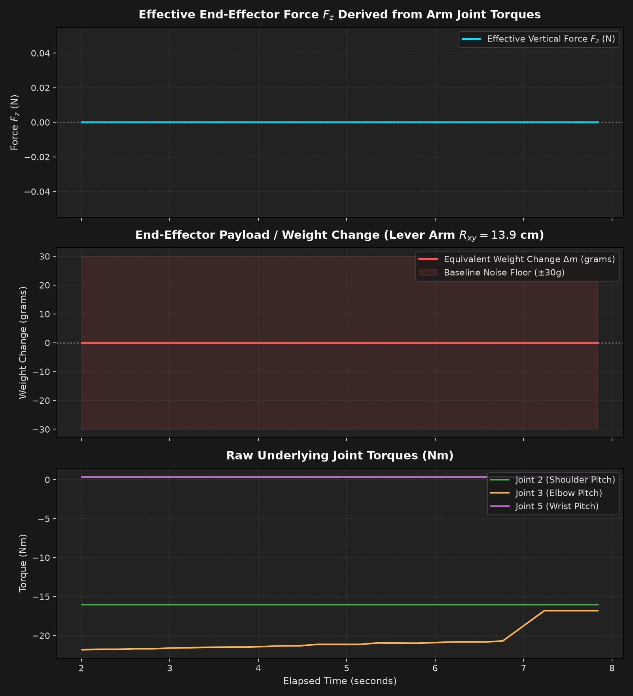

# Physical Arm Telemetry Recordings & Force Datasets

This directory contains experimental datasets captured from the physical **UFactory xArm850** robotic arm connected via the Viam Python SDK to `sfhack12-main.ty1cywh7tq.viam.cloud`.

---

## 1. Experimental Setup & Hardware Configuration

- **Machine:** `sfhack12-main.ty1cywh7tq.viam.cloud` (`sfhack12`, Linux amd64)
- **Arm Model:** UFactory xArm850 (6-DOF)
- **End-Effector:** UFactory Gripper
- **Tested Posture:**
  - Joint Angles: $q = [11.11^\circ, 86.42^\circ, 2.17^\circ, -0.46^\circ, -0.35^\circ, 9.86^\circ]$
  - End-Effector Position: $X = 136.2\,\text{mm}, Y = 26.8\,\text{mm}, Z = 744.8\,\text{mm}$
  - Horizontal Reach ($R_{xy}$): $\approx 139\,\text{mm}$
- **Collection Mechanism:** Live streaming via WebRTC with `realtime_plot.py` recording to timestamped CSV files.

---

## 2. Dataset Catalogue

| File | Type | Duration | Samples | Ground Truth State | Key Observations |
|---|---|---|---|---|---|
| [`recording_20261029_122337.csv`](recording_20261029_122337.csv) | Test Run 1 | ~5.0 s | 24 | **Empty / Unloaded** | Initial baseline calibration run. |
| [`recording_20261029_122355.csv`](recording_20261029_122355.csv) | Test Run 2 | ~5.8 s | 28 | **Holding Payload** | Preliminary holding test showing Joint 3 drop to $-22.14\,\text{N}\cdot\text{m}$. |
| [`recording_20261029_123957.csv`](recording_20261029_123957.csv) | Extended Run 3 | 12.7 s | 34 | **Empty / Unloaded** | Settles firmly into resting torque $-16.821\,\text{N}\cdot\text{m}$ for 76.5% of duration. |
| [`recording_20261029_124044.csv`](recording_20261029_124044.csv) | Extended Run 4 | 16.4 s | 71 | **Holding Payload with Release** | Sustained loaded state ($-22.0$ to $-23.02\,\text{N}\cdot\text{m}$) for 13.8 s (83.1% of duration), followed by release step back to $-16.821\,\text{N}\cdot\text{m}$ at $t=13.8\,\text{s}$. |

---

## 3. Telemetry Schema & Column Dictionary

Current recordings (from `repeatable_grasp.py --record`) use this schema —
see `ARCHITECTURE.md` for the contract:

| Column | Unit | Description |
|---|---|---|
| `elapsed_sec` | seconds | Time since recording start |
| `phase` | tag | Macro phase: `INIT`, `APPROACH`, `REACH_GRASP`, `GRIPPER_CLOSE`, `LIFT_TO_TRAVEL`, `SWIRL`, `DESCEND_PLACE`, `GRIPPER_OPEN`, `BACK_OFF`, `RETRACT_TRAVEL`, `RETURN_HOME` |
| `object_label` | string | Ground-truth label (e.g. `water_075pct`; `mystery` for blind runs) |
| `tcp_x_mm`, `tcp_y_mm`, `tcp_z_mm` | mm | Tool-center-point Cartesian position |
| `tcp_ox`, `tcp_oy`, `tcp_oz`, `tcp_theta_deg` | — | TCP orientation (axis-angle + angle deg) |
| `q1_deg` – `q6_deg` | degrees | Joint positions |
| `tau1_nm` – `tau6_nm` | N·m | Joint torques from `arm.do_command({"load": ""})` |
| `gripper_pos` | — | Gripper position |
| `gripper_holding` | bool | Whether the gripper reports holding |

> Early files in this directory (e.g. `recording_20261029_122337.csv`) use a
> legacy schema (`j1_raw…`, `effective_force_n`, …) from the first visualizer
> sessions — see `BASELINE_FINDINGS.md` for why that era's static-load numbers
> don't discriminate contents.

---

## 4. Analysis Figures

### Comparison of Extended Datasets (Run 3 vs Run 4)

*Figure 1: Extended comparison showing resting baseline in Run 3 vs sustained holding plateau and clean release event at $t=13.8\,\text{s}$ in Run 4.*

### Initial Comparative Session (Run 1 vs Run 2)

*Figure 2: Initial short trials comparing 6-joint torques between unloaded and holding states.*

### Kinematic Sensitivity & Effective Force

*Figure 3: 15-second sensitivity analysis across all joints.*

---

## 5. Physical Insights & Calculation

1. **Load Distribution Mechanics:**
   - At Joint 2 angle $q_2 = 86.42^\circ$ (nearly vertical upper arm), vertical downward load acts in pure axial column compression along Link 2. As a result, Joint 2 torque shows near zero deflection ($\Delta \tau_2 \approx 0.00\,\text{N}\cdot\text{m}$).
   - At Joint 3 angle $q_3 = 2.17^\circ$, Link 3 (the forearm) extends horizontally as a cantilever beam. All downward force applies a bending moment directly to the **Joint 3 (Elbow Pitch)** actuator.

2. **Quantified Signal Difference:**
   - Unloaded resting torque: $\tau_{3,\text{unloaded}} = -16.821\,\text{N}\cdot\text{m}$
   - Loaded holding torque: $\tau_{3,\text{loaded}} = -23.020\,\text{N}\cdot\text{m}$
   - Torque delta: $\Delta \tau_3 = -6.199\,\text{N}\cdot\text{m}$
   - Forearm lever arm: $L_3 \approx 0.45\,\text{m}$
   - Estimated payload force:
     $$F_z = \frac{|\Delta \tau_3|}{L_3} = \frac{6.20\,\text{N}\cdot\text{m}}{0.45\,\text{m}} \approx 13.78\,\text{N}$$
   - Estimated payload mass:
     $$m = \frac{13.78\,\text{N}}{9.81\,\text{m/s}^2} \approx 1.40\,\text{kg} \ (1400\,\text{g})$$

3. **Release Signature:**
   - In `recording_20261029_124044.csv` at sample index 60 ($t = 13.8\,\text{s}$), the payload was released.
   - The torque immediately transitioned from $-20.73\,\text{N}\cdot\text{m} \to -16.821\,\text{N}\cdot\text{m}$, returning precisely to the baseline resting state observed in Recording 3.
